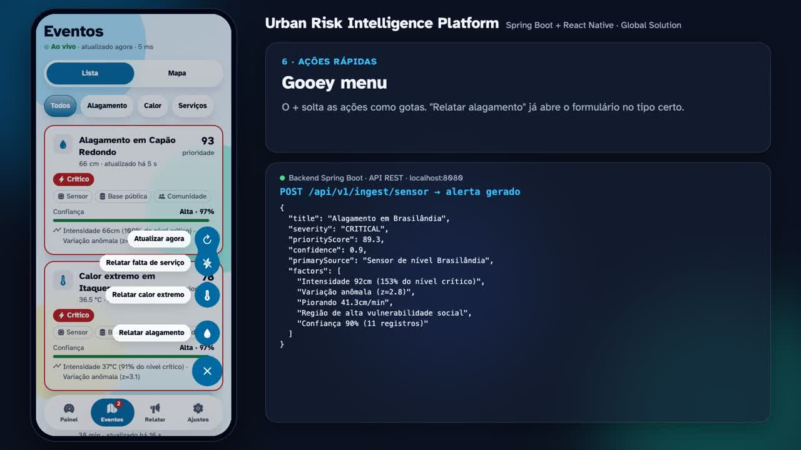

# Urban Risk Intelligence Platform

Plataforma integrada de monitoramento e análise de **riscos urbanos cotidianos**: alagamentos, ilhas de calor e interrupções de serviços essenciais.

- **Backend** em Java 17 + Spring Boot 4. Recebe dados de **sensores**, **bases públicas** e **relatos da comunidade**, persiste tudo e prioriza alertas com um motor de análise explicável. Cada dado e cada alerta informa a **origem** e o **nível de confiança**.
- **App mobile** em React Native (Expo SDK 58). Tem painel ao vivo, lista e mapa de eventos, notificações de alerta, relato comunitário anônimo e um modo offline que **não trava** quando o servidor cai e **se recupera sozinho** quando ele volta.

> Disciplina: Advanced Programming And Mobile Dev — Global Solution

## Vídeo de demonstração

[](docs/demo/urban-risk-demo.mp4)

**[▶ Assistir ao vídeo (3min49s)](docs/demo/urban-risk-demo.mp4)**. O vídeo mostra:

- a API rodando e o app recebendo dados em tempo real;
- a priorização dos alertas e o relato anônimo;
- o backend sendo **parado**, com o app avisando que está desconectado sem travar;
- a **reconexão automática**.

## Integrantes

| Nome completo | RM |
|---|---|
| Juan Alberto Lenis Rodriguez | RM559744 |
| Kagio Miura | RM559212 |

---

## Sumário

1. [Arquitetura](#arquitetura)
2. [Como executar](#como-executar)
3. [Como cada requisito foi atendido](#como-cada-requisito-foi-atendido)
4. [Análise e priorização (recurso de IA)](#análise-e-priorização-recurso-de-ia)
5. [API REST](#api-rest)
6. [Roteiro da apresentação](#roteiro-da-apresentação)
7. [Indicadores](#indicadores)
8. [Testes](#testes)

---

## Arquitetura

```
urban-risk-intelligence-platform/
├── backend/            Spring Boot (API REST, análise, persistência, simulador)
├── mobile/             React Native / Expo (app para moradores e agentes locais)
├── infra/nginx.conf    Balanceador para o modo escalável (docker compose)
├── docker-compose.yml  Postgres + 2 réplicas da API + simulador + gateway
├── design-system/      Design system do app (gerado com a skill ui-ux-pro-max)
└── scripts/demo.sh     Chamadas de exemplo para a demonstração
```

```
 Sensores IoT ─┐  X-API-Key                                         ┌─▶ GET /alerts (por prioridade)
 Bases públicas┼──▶ /ingest/* ─▶ IngestionService ─▶ PriorityEngine ─┼─▶ GET /dashboard, /observations
 Comunidade ───┘  rate limit     │ PrivacyGuard (LGPD)  │ Confidence  └─▶ GET /stream (SSE)
                                 ▼                      ▼
                            Observation  ───────▶  Alert (score, severidade, confiança, fatores)
                                 └──── JPA / H2 (dev) ou PostgreSQL (prod) ────┘
                                                        ▲
 App mobile ── polling 5 s + backoff ── cache offline ──┘   notificações locais em alertas novos/piorados
```

### Backend: camadas

| Camada | Pacote | Responsabilidade |
|---|---|---|
| Web | `web.controller`, `web.dto`, `web.error` | Endpoints REST, validação (Bean Validation), erros em RFC 9457 |
| Serviço | `service` | Ingestão, consolidação de alertas, painel, rotinas de manutenção |
| Análise | `service.analysis` | `ConfidenceCalculator` e `PriorityEngine` (priorização) |
| Privacidade | `service.privacy` | `PrivacyGuard`: pseudonimização, arredondamento de coordenadas, remoção de dados pessoais |
| Domínio | `domain.model`, `domain.repository` | Entidades JPA (`DataSource`, `Observation`, `Alert`) e repositórios |
| Tempo real | `realtime` | Broadcast de alertas via Server-Sent Events |
| Simulação | `simulation` | Gera sensores, base pública e relatos realistas para a demo |
| Config | `config` | CORS, API key para sensores, limite de relatos por IP |

### Mobile: estrutura

| Pasta | Conteúdo |
|---|---|
| `src/app` | Telas (Expo Router): Painel, Eventos (lista/mapa), Relatar, Ajustes, Detalhe do alerta |
| `src/state` | `LiveDataProvider` (sincronização, cache offline, fila de relatos, notificações) |
| `src/logic` | Regras puras e testadas: máquina de estados da conexão, diff de alertas, formatação, fila offline |
| `src/components` | Componentes acessíveis (banner de conexão, cards, selos, medidor de confiança, mapa) |
| `src/theme` | Tokens do design system (cores AA, tipografia Atkinson Hyperlegible, espaçamento, movimento) |

---

## Como executar

### Pré-requisitos

- **Java 17+**. O Maven não precisa estar instalado, porque o projeto usa o wrapper `./mvnw`.
- **Node.js 20+** e npm.
- Para testar no celular: o app **Expo Go** (Android/iOS), com o celular **na mesma rede Wi-Fi** do computador.
- Opcional: Docker, para o modo escalável com PostgreSQL.

### 1. Backend (Spring Boot)

```bash
cd backend
./mvnw spring-boot:run          # Windows: mvnw.cmd spring-boot:run
```

- A API sobe em `http://localhost:8080`, com banco H2 em arquivo (`backend/data/`).
- O **simulador urbano** já começa a gerar dados: sensores a cada 5 s, base pública a cada 30 s e relatos a cada 20 s.
- Para conferir:
  - saúde: `curl http://localhost:8080/actuator/health`
  - alertas: `curl http://localhost:8080/api/v1/alerts`
- Exemplos de ingestão: `./scripts/demo.sh`
- Console do banco: `http://localhost:8080/h2-console` (JDBC URL `jdbc:h2:file:./data/urbanrisk`, usuário `sa`).

Variáveis úteis:

| Variável | Padrão | Uso |
|---|---|---|
| `PORT` | `8080` | Porta HTTP |
| `SIMULATION_ENABLED` | `true` | Liga/desliga o simulador |
| `INGEST_API_KEY` | `dev-ingest-key` | Chave exigida de sensores e bases públicas (`X-API-Key`) |
| `PRIVACY_SALT` | (dev) | Salt do hash dos relatores — **troque em produção** |

Para gerar o jar: `./mvnw package` e depois `java -jar target/backend-0.0.1-SNAPSHOT.jar`.

### 2. App mobile (React Native / Expo)

```bash
cd mobile
npm install
npx expo start
```

- **No celular:** escaneie o QR code com o Expo Go (Android) ou com a câmera (iOS). O app descobre sozinho o IP do computador a partir do servidor do Expo e procura a API em `http://<ip-do-computador>:8080`.
- **Emulador Android:** aperte `a`. A API é acessada em `10.0.2.2:8080`.
- **Simulador iOS:** aperte `i`.
- **Navegador:** aperte `w`. O mapa vira uma visão esquemática.

Se a API estiver em outro endereço, você tem duas opções:

- iniciar com `EXPO_PUBLIC_API_URL=http://192.168.0.10:8080 npx expo start`;
- trocar o endereço dentro do app, em **Ajustes → Servidor → Testar → Salvar**.

> Se o celular não conectar, libere a porta 8080 no firewall do computador e confira se os dois estão na mesma rede.

### 3. Modo escalável (opcional, Docker)

```bash
docker compose up --build
```

Esse modo sobe:

- PostgreSQL;
- **2 réplicas** da API, sem estado;
- uma instância com o simulador;
- um nginx que balanceia as chamadas e tira do ar a réplica que falhar.

A API continua em `http://localhost:8080`.

---

## Como cada requisito foi atendido

### Backend

| # | Requisito | Implementação |
|---|---|---|
| 1 | Receber e organizar dados de sensores, bases públicas e comunidade | Três endpoints de ingestão: `POST /api/v1/ingest/sensor`, `/public` (lote) e `/community`. Tudo é normalizado num `IngestCommand` único, associado a uma `DataSource` com tipo e confiabilidade, e agrupado por região e tipo de risco. |
| 2 | Persistir os dados | JPA/Hibernate com H2 (dev) ou PostgreSQL (perfil `postgres`). Há índices em região/tipo/tempo e em status/prioridade, e `@Version` para concorrência otimista nos alertas. |
| 3 | API REST que priorize alertas | `GET /api/v1/alerts` já vem ordenado por `priorityScore` (0–100) e severidade, com filtros e paginação, sincronização incremental (`since`) e stream SSE. |
| 4 | Origem e nível de confiança de cada dado | Cada observação traz `source` (código, nome, tipo, confiabilidade) e `confidence`. Cada alerta traz `sources`, `primarySource`, `confidence` agregada e os `factors` que explicam a nota. |

### Mobile

| # | Requisito | Implementação |
|---|---|---|
| 5 | Painel de acompanhamento | Tela **Painel**. Mostra primeiro o resumo "estou em risco agora?", depois o alerta mais urgente com orientação, os indicadores (alertas ativos, confiança média, registros/h, último dado), os alertas por tipo de risco e o feed de registros com origem e confiança. |
| 6 | Lista ou mapa de eventos | Tela **Eventos**, que tem **as duas** visões (lista priorizada e mapa com raio por severidade) e filtros por tipo de risco. |
| 7 | Notificações de alerta | Notificação local quando surge um alerta **alto/crítico** ou quando um alerta **piora**, com vibração. Tocar na notificação abre o detalhe. Na primeira carga não dispara uma rajada de notificações. |
| 8 | Interface simples, acessível e fácil | Há perfis **Morador** (o essencial e o que fazer) e **Agente local** (fontes, todos os fatores e a opção de encerrar alerta). A acessibilidade está detalhada logo abaixo. |

Detalhes de acessibilidade do requisito 8:

- fonte Atkinson Hyperlegible, criada para baixa visão;
- contraste AA e modo escuro;
- alvos de toque de pelo menos 44 px;
- severidade indicada por ícone e texto, nunca só por cor;
- rótulos e anúncios para leitor de tela;
- respeito a "reduzir movimento";
- texto escalável até 160%.

### Técnicos

| Requisito | Implementação |
|---|---|
| Arquitetura em camadas | Backend: web → serviço → análise/privacidade → domínio/repositório. Mobile: telas → estado → lógica pura → API. |
| Testes | 25 testes no backend (unitários + integração com MockMvc) e 17 no mobile (Jest). Veja [Testes](#testes). |
| IA / análise para priorizar | `PriorityEngine`: score multifatorial com detecção de anomalia (z-score), tendência (regressão linear), vulnerabilidade social e confiança por fusão de evidências. Veja a próxima seção. |
| Escalabilidade | API sem estado e paginada, com índices no banco. Threads virtuais (Java 21+, quando disponível). Compressão HTTP e `docker-compose` com 2 réplicas atrás do nginx e PostgreSQL. O app faz sincronização incremental. |
| Disponibilidade | Health checks (`/actuator/health` com liveness/readiness), desligamento gracioso, `restart: unless-stopped` e failover no nginx. O app é **offline-first**: cache local, backoff exponencial, reconexão automática e fila de relatos. |
| Proteção de dados pessoais (LGPD) | Detalhada logo abaixo. |

Medidas de LGPD:

- O id do relator vira um **hash SHA-256 com salt**; o identificador original nunca é salvo.
- Coordenadas são **arredondadas para ~110 m**.
- **E-mails, telefones e CPFs** são removidos do texto livre.
- Há **retenção de 30 dias** com limpeza diária.
- Sensores e bases públicas precisam de **API key**, e os relatos têm **limite por IP**.
- O app usa um id anônimo, sem conta e sem IMEI.

---

## Análise e priorização (recurso de IA)

O `PriorityEngine` (`backend/src/main/java/br/com/urbanrisk/service/analysis/PriorityEngine.java`) calcula uma **nota de 0 a 100** para cada alerta, com cinco fatores **explicáveis**:

| Fator | Peso | Como é calculado |
|---|---|---|
| Intensidade | 35% | Quanto o valor atual passa do limiar de atenção, normalizado até o limiar crítico de cada risco (alagamento 20→60 cm, calor 34→40 °C, falta de serviço 30→180 min). |
| Anomalia | 20% | **z-score** do valor atual frente ao histórico da última hora na mesma região. Detecta mudança brusca mesmo abaixo do limiar. |
| Tendência | 15% | **Regressão linear** das leituras recentes, projetando a piora em 15 minutos. |
| Vulnerabilidade | 15% | Índice social da região: o mesmo alagamento pesa mais onde a população tem menos capacidade de resposta. |
| Confiança | 15% | Fusão das evidências das fontes (veja abaixo). |

Para evitar alertas "pisca-pisca", um alerta só é encerrado automaticamente quando a nota cai abaixo de 20 **e** nenhuma leitura dos últimos 10 minutos passou do limiar de atenção (histerese).

Depois a nota é **multiplicada pela confiança** (`× (0,5 + 0,5·confiança)`). Assim, um único relato exagerado não passa à frente de um alerta confirmado por sensores. A nota define a severidade: **Baixo** (até 35), **Moderado** (35 a 55), **Alto** (55 a 75) e **Crítico** (75 ou mais). Um alerta abre a partir de 35 e é encerrado sozinho abaixo de 20 ou depois de 15 min sem dados novos.

**Confiança** (`ConfidenceCalculator`):

- **Confiabilidade-base da fonte:** sensor 0,90, base pública 0,80, comunidade 0,55.
- **Frescor:** a confiança cai pela metade a cada 30 min.
- **Plausibilidade:** leituras fisicamente impossíveis são penalizadas.
- **Fusão das evidências:** cada **emissor distinto conta uma vez**. Repetir o mesmo sensor ou a mesma pessoa não infla a confiança. Emissores distintos se combinam como evidências parcialmente independentes, e origens diferentes (sensor + base pública + comunidade) ganham um bônus de diversidade.

A API devolve os fatores em texto, por exemplo `"Variação anômala (z=4.7)"` ou `"Região de alta vulnerabilidade social"`. O app mostra esses fatores em **"Por que esta prioridade?"**, o que deixa a decisão auditável por agentes e moradores.

---

## API REST

Base: `http://localhost:8080/api/v1`

| Método | Rota | Descrição |
|---|---|---|
| `POST` | `/ingest/sensor` | Leitura de sensor (`X-API-Key` obrigatório) |
| `POST` | `/ingest/public` | Lote de base pública (`X-API-Key` obrigatório) |
| `POST` | `/ingest/community` | Relato de morador/agente (anônimo, com limite por IP) |
| `GET` | `/alerts?status=ACTIVE&riskType=&minPriority=&since=&page=&size=` | Alertas **ordenados por prioridade** |
| `GET` | `/alerts/{id}` | Detalhe do alerta |
| `PATCH` | `/alerts/{id}/resolve` | Encerrar alerta (agente local) |
| `GET` | `/dashboard` | Resumo para o painel |
| `GET` | `/observations?page=&size=` | Registros recentes com origem e confiança |
| `GET` | `/sources` | Fontes cadastradas e sua confiabilidade |
| `GET` | `/ping` | Latência e estado (usado pelo app) |
| `GET` | `/stream` | Server-Sent Events (`alert.created`, `alert.updated`, `heartbeat`) |
| `GET` | `/actuator/health` | Saúde (liveness/readiness) |

Exemplo de alerta:

```json
{
  "id": 10, "riskType": "FLOOD", "title": "Alagamento em Brasilândia",
  "severity": "CRITICAL", "priorityScore": 84.4, "confidence": 0.9,
  "latestValue": 85.0, "unit": "cm",
  "sources": ["SENSOR"], "primarySource": "Sensor demo Brasilândia",
  "factors": ["Intensidade 85cm (142% do nível crítico)", "Variação anômala (z=83.2)",
              "Piorando 1.5cm/min", "Região de alta vulnerabilidade social", "Confiança 90% (37 registros)"],
  "status": "ACTIVE"
}
```

Os erros seguem `application/problem+json`, por exemplo `400` com `fields.latitude`, `401` sem API key e `429` com excesso de relatos.

---

## Roteiro da apresentação

1. **API rodando:** `cd backend && ./mvnw spring-boot:run`. Mostre `curl localhost:8080/api/v1/alerts` e rode `./scripts/demo.sh`, que exercita as três origens, a priorização, a anonimização e o erro 401.
2. **App recebendo em tempo real:** `cd mobile && npx expo start` e abra no Expo Go.
   - O Painel mostra **"Ao vivo · atualizado agora · NN ms"**.
   - Novos alertas aparecem sozinhos a cada ~5 s.
   - Envie um alerta crítico pelo `demo.sh`: a notificação chega no celular.
3. **Backend parado:** pare o processo da API (Ctrl+C).
   - Em ~5 s o app mostra a faixa vermelha **"Sem conexão com o servidor · mostrando dados salvos às HH:MM · nova tentativa em N s"**.
   - O indicador passa para "Desconectado".
   - Tudo continua navegável: lista, mapa e detalhes funcionam com o cache.
   - Um relato enviado agora fica **na fila** ("enviaremos quando a conexão voltar").
4. **Reconexão:** suba a API de novo.
   - Sem tocar no app, aparece a faixa verde **"Conexão restabelecida · dados atualizados"**.
   - Os dados se atualizam e a fila de relatos é enviada sozinha.
   - O botão **Tentar** força uma nova tentativa a qualquer momento.

Medido em teste automatizado: a queda é detectada em **~4,5 s** e a reconexão acontece **~4,5 s** depois que a API volta.

---

## Indicadores

| Indicador | Como é atendido e medido |
|---|---|
| **Tempo de atualização** | O app sincroniza a cada **5 s**. O indicador "atualizado há X s · NN ms" mostra a idade do dado e a latência da última resposta, e o painel mostra quando chegou o último registro. O SSE (`/stream`) entrega eventos em tempo real para integrações. Em queda, o backoff vai de 2 s a 30 s, e o app tenta na hora quando a rede ou o app voltam. |
| **Qualidade dos alertas** | Os alertas consolidam várias leituras (sem duplicar), têm confiança por fusão de evidências e são penalizados quando há uma única fonte pouca confiável. Encerram sozinhos quando o risco passa e trazem fatores explicáveis. Os testes cobrem: o mesmo evento pesa mais em região vulnerável, um relato isolado vale menos que um sensor, e spam da mesma pessoa não infla a confiança. |
| **Facilidade de uso** | Há dois perfis (Morador/Agente) e a orientação prática "O que fazer" em cada alerta. Relatar leva 4 passos em menos de 30 s. A acessibilidade segue WCAG AA (contraste, toque de 44 px, leitor de tela, fonte legível, modo escuro, reduzir movimento). |

### Design

Design system gerado com a skill **ui-ux-pro-max**: paleta navy/azul de alto contraste e tipografia Atkinson Hyperlegible. Ele está em [`design-system/urban-risk/MASTER.md`](design-system/urban-risk/MASTER.md).

A estética é **glassmorphism**:

- superfícies de vidro fosco (`expo-blur`) sobre um fundo vibrante (gradiente + manchas de cor);
- borda clara de 1 px e reflexo de luz no topo;
- preenchimento translúcido calibrado para manter o contraste de texto em 4.5:1 (claro e escuro).

A navegação é uma **tab bar flutuante de vidro com sliding pill**: uma pílula sólida desliza até a aba ativa com spring sem overshoot. A mesma pílula é usada no seletor Lista/Mapa.

Ações rápidas ficam num **gooey menu**: o botão "+" solta as ações como gotas que se fundem (metaball com filtro SVG de blur + matriz de alfa). As ações são relatar alagamento, calor extremo ou falta de serviço (já abre o formulário no tipo certo) e atualizar agora.

O movimento segue a skill **design-motion-principles** (lentes de "polimento de produção" e "contenção", para app mobile):

- só anima o que comunica mudança de estado (faixa de conexão, entrada de alerta novo);
- durações de 160–320 ms;
- sem animação em ações frequentes;
- tudo é desligado com "reduzir movimento".

---

## Testes

```bash
# Backend: 25 testes (análise, confiança, privacidade e integração da API)
cd backend && ./mvnw test

# Mobile: 17 testes (conexão/reconexão, notificações, fila offline, formatação) + typecheck
cd mobile && npm test && npm run typecheck
```

| Suíte | O que garante |
|---|---|
| `PriorityEngineTest` | Leituras normais ficam baixas, um evento corroborado vira crítico, a vulnerabilidade pesa, um relato isolado fica abaixo de um sensor, anomalias são detectadas e a tendência é calculada |
| `ConfidenceCalculatorTest` | Hierarquia de fontes, meia-vida, plausibilidade, corroboração, anti-spam e confiança nunca chegando a 100% |
| `PrivacyGuardTest` | Hash estável e irreversível, arredondamento de coordenadas e remoção de telefone, e-mail e CPF |
| `ApiIntegrationTest` | 401 sem chave, abertura de alerta com origem e confiança, ordenação por prioridade, anonimização persistida, 400 com ProblemDetail, painel e encerramento de alerta |
| `connection.test.ts` | Instável vs. desconectado, aviso de "reconectado" só após queda real, rede do aparelho e backoff |
| `alertDiff.test.ts` | Notifica só alertas novos ou que pioraram (alto/crítico), sem rajada na primeira carga |
| `reportQueue.test.ts` | Fila offline: limite, envio ao reconectar, parada no erro de rede e descarte de rejeitados |
